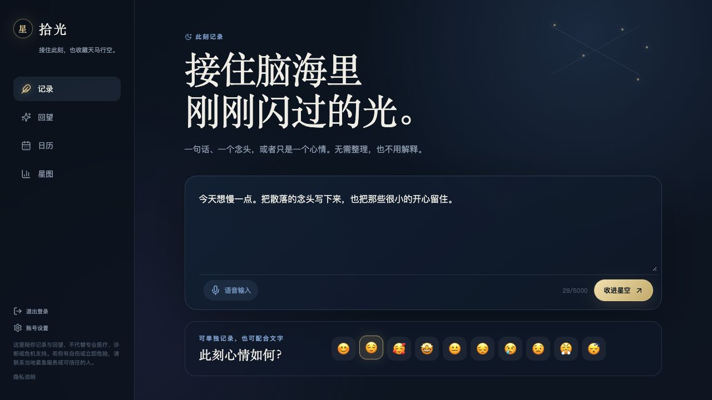
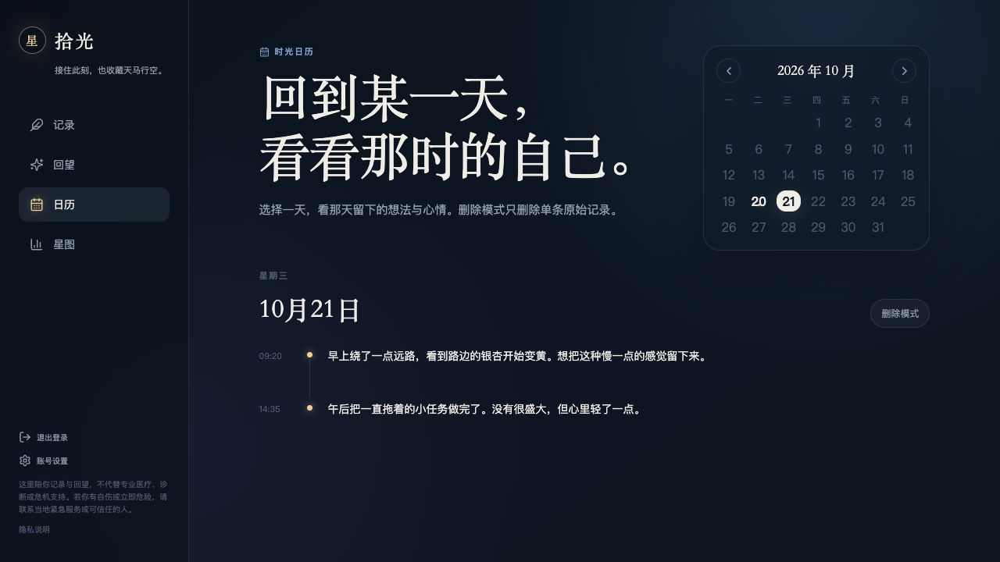
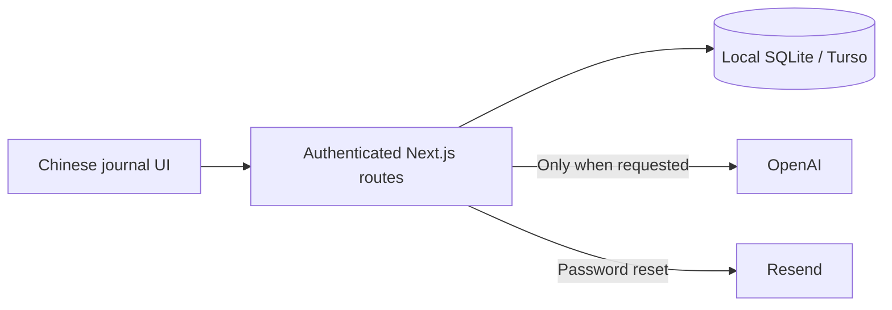

<div align="center">


**A quiet, self-hosted journal for fleeting thoughts, moods, and optional AI reflections.**

[简体中文](README.zh-CN.md) · [Quick start](#quick-start) · [Deployment](docs/DEPLOYMENT.md) · [Contributing](CONTRIBUTING.md)


</div>

Shiguang (拾光, “collecting light”) makes space for the things that do not arrive as a finished story: a thought between tasks, a small idea, a passing feeling. Capture them in Chinese, revisit them on a calendar, and choose whether to turn a day's fragments into a reflection.

The interface is in Chinese. The project is designed for personal use and self-hosting; it is an early-stage application, not an audited multi-user service.

## A small daily rhythm

| Capture | Revisit | Reflect |
| --- | --- | --- |
| Write a sentence, tap a mood, or use supported browser speech input. | Follow your original entries through a calendar and timeline. | Generate daily reflections or 7/30-day trends when you choose. |

## Features

- **Low-friction capture:** text, standalone mood emoji, and browser-dependent Chinese speech recognition.
- **Calendar review:** original entries and saved daily reflections organized by day.
- **Optional AI:** user-triggered OpenAI reflections and trends. Without a key, a deterministic fallback gives an honest overview rather than inventing psychological explanations.
- **Your original words stay separate:** AI output never replaces raw entries.
- **Accounts and data controls:** email/password sign-in, password reset, account deletion, and Markdown/JSON exports by date range.
- **A mobile-first, night-sky interface:** responsive navigation, app icons, and a web app manifest. Private pages and journal APIs are not service-worker cached; this is not an offline journal.

## Screenshots

All screenshots use invented entries in a disposable local database. No personal journal data is included.





## Quick start

Requires **Node.js 22.13+** and npm. `.nvmrc` selects Node 22.

```bash
git clone https://github.com/ViolaSongsy/shiguang.git
cd shiguang
nvm use                       # optional, if you use nvm
npm ci
cp .env.example .env.local
npm run dev
```

Open [localhost:3000](http://localhost:3000), create a local account, and write your first entry. The default database is `data/anxiety-journal.db`; no Turso, OpenAI, or email service is needed for local exploration. Local reset links are printed to the terminal when email delivery is not configured.

For production-style local testing:

```bash
npm run build
npm start
```

Stop the development server before building; both commands use `.next/`.

## Configuration

Copy `.env.example` and add only the services you need. All credentials stay on the server. Never commit `.env.local`.

| Variable | Purpose |
| --- | --- |
| `TURSO_DATABASE_URL` | libSQL URL. Omit for a local file; use a remote Turso database for Vercel. |
| `TURSO_AUTH_TOKEN` | Token for your remote database. |
| `OPENAI_API_KEY` | Enables real AI reflections. Omit to use the fallback overview. |
| `OPENAI_MODEL` | Model name; currently defaults to `gpt-4o-mini`. |
| `APP_URL` | Canonical app URL used in password-reset links. Set your HTTPS domain when hosting. |
| `RESEND_API_KEY` | Sends real password-reset emails. Without it, links are logged to the server. |
| `EMAIL_FROM` | A sender allowed by your email provider. |
| `TRUSTED_PROXY_IP_HEADER` | `x-vercel-forwarded-for` or `x-real-ip`, only behind a proxy that overwrites it. |

Local and hosted databases are separate unless you deliberately configure the same database. Pushing Git commits does not upload, back up, or synchronize journal entries.

## How it works

Read [Design decisions](docs/DESIGN.md) for the product problem, implementation focus, tradeoffs, and failures turned into tests.



The browser handles capture and calendar views. Server routes validate requests, obtain the current session, and scope journal queries to that user. Daily reflections are saved separately from original entries. Trend responses are generated from selected saved reflections and are not a separate persisted database entity.

| Directory | Responsibility |
| --- | --- |
| `app/` | Pages, styles, and API routes |
| `components/` | Shared layout, session/journal state, and reflection views |
| `lib/` | Database setup, authentication, dates, email, and rate limits |
| `public/` | Icons, manifest, and static-only service worker |
| `tests/` | Disposable-database HTTP integration tests |
| `docs/` | Hosting, privacy, screenshots, and roadmap |

## Checks

```bash
npm run lint
npm run typecheck
npm run build
npm run test:integration
```

The integration suite launches a separate local production server, uses temporary SQLite data, and disables real email and AI calls. It checks rate-limit isolation, email-casing and spoofed-header resistance, and trusted-proxy behavior. GitHub Actions runs these checks for pull requests and pushes to `master`.

## Hosting and privacy

See **[Deployment](docs/DEPLOYMENT.md)** for Vercel + Turso and persistent Node hosting, and **[Privacy and data flow](docs/PRIVACY.md)** for what leaves your server.

Journal text is **not end-to-end encrypted**. Your hosting/database administrators can read it. AI requests send selected text to OpenAI; browser speech recognition can use a browser vendor's remote service. Password hashing does not encrypt journal content.

Shiguang is a journaling tool, not medical care, diagnosis, therapy, or a crisis service. See the [security policy](SECURITY.md) and [roadmap](docs/ROADMAP.md) for remaining limitations before operating a shared instance.

## Contribute

Bug reports, accessibility fixes, and focused improvements are welcome in English or Chinese. Read [CONTRIBUTING.md](CONTRIBUTING.md); use fictional text in issues and screenshots, and report vulnerabilities privately.

## License

[MIT](LICENSE) © 2026 ViolaSongsy. The license covers the code and repository assets, not an operator's hosted user data or third-party service terms.
